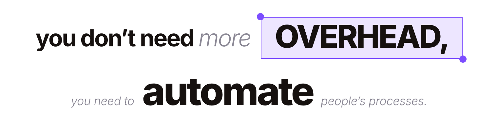
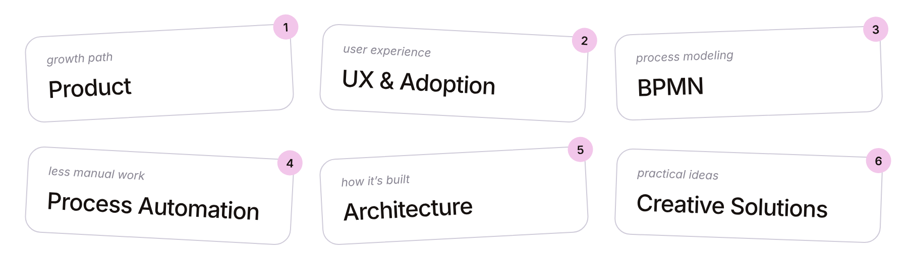

<picture>
  <source media="(prefers-color-scheme: dark)" srcset="./.idea/assets/header-dark.png">
  <source media="(prefers-color-scheme: light)" srcset="./.idea/assets/header-light.png">
  
</picture>
<h3>Hi, I’m Luiza Caldeira</h3>
 

Software engineer working with process modeling and automation, 
with a focus on creating solutions people actually adopt.

<h3>About Me</h3>
 

I work with process modeling and automation, and I develop with JavaScript. 
I enjoy solving real problems, designing creative solutions, 
and paying close attention to the user experience and how people adopt what I build.

I’m studying Information Systems at the Federal University of Juiz de Fora, Brazil, 
and I’m committed to continuous learning as I grow toward a career in product.

<h3>Interests</h3>
 
<picture>
  <source media="(prefers-color-scheme: dark)" srcset="./.idea/assets/interests-dark.png">
  <source media="(prefers-color-scheme: light)" srcset="./.idea/assets/interests-light.png">
  
</picture>
<h3>Tech Stack</h3>
 

<h3>Get in Touch</h3>
 

 
 
©2026 Luiza Caldeira
 

 
